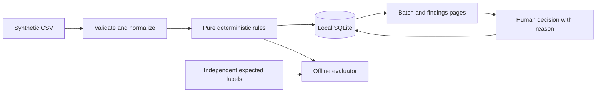

# Architecture proposal

Status (updated 2026-10-21): this was the pre-implementation proposal. **The approaches table is superseded.** Stage 1 was built with the Python 3.12 standard library (`http.server`, `sqlite3`, `csv`), not FastAPI/Jinja, because no installs were authorized. The CSV contract, rule semantics, evidence and review behaviour below were implemented as specified, with the refinements listed in [stage1-implementation-plan.md](stage1-implementation-plan.md) §8. One addition: the upload sends the raw file bytes with a CSRF header, so the hash covers the original bytes. The Next.js / FastAPI / PostgreSQL direction remains the gated growth path. Results: [stage1-verification-report.md](stage1-verification-report.md).

## Approaches considered

| Approach | Benefit | Cost / limitation | Recommendation |
| --- | --- | --- | --- |
| Python + FastAPI + server-rendered Jinja pages + SQLite | One application process; clear rule tests; local history; a browser demo | Less frontend-framework practice | Recommended for a small, measurable first delivery |
| TypeScript + React + Node API + SQLite | More explicit frontend/backend portfolio work | Additional build/tooling and interface coordination | Choose if React/TypeScript practice is the primary résumé goal |
| Python command-line report | Smallest rule-engine experiment | Does not demonstrate the review/history interaction well | Useful internal testing interface, not the recommended whole product |

No dependencies are installed or pinned here. After agreement, inspect the selected runtime and propose exact dependency versions in the implementation plan. FastAPI documents [server-rendered templates](https://fastapi.tiangolo.com/advanced/templates/); SQLite supplies [atomic transactions](https://www.sqlite.org/transactional.html). Python supports [exact decimal representations](https://docs.python.org/3/library/decimal.html), though this scope can parse validated two-decimal strings directly into integer cents and perform all money arithmetic as integers.

## Flow and boundaries

This is a first-stage local simplification. The earlier direction (Next.js/TypeScript UI, Python analysis, PostgreSQL and secure document storage) remains an option for Claude's plan. Preserve entity relationships for the future financial knowledge graph and separate rules from connectors and models.

The importer validates and preserves input. The rule engine takes immutable normalized invoices and returns findings without database, HTTP, or AI dependencies. Storage preserves the batch, source values, ruleset version, evidence, and review events. The UI reads these facts and submits review actions. Evaluation compares the engine output with independently specified truth, never with labels inferred by the engine itself.

Run a single process bound to loopback (`127.0.0.1`) for one local operator. Serve static resources locally. Restrict Host/Origin and protect state-changing forms against cross-site requests; loopback alone is not authorization. Do not enable broad CORS or expose a network listener. Local reviewer names are self-declared attribution, not verified identity.

## CSV contract

Stage 1 screens include a Financial Risk Command Center with a prominent synthetic-data label, batch identity and rule/review counts; prioritized cases; source-backed investigation with exact calculations; recommended review steps; and decision/history controls. Use transparent ordering (open before resolved, then rule and record ID) instead of invented risk probabilities or savings. Initial reporting summarizes synthetic counts/limitations; executive AI reporting remains on the roadmap.

One row represents one invoice, with exactly these columns in this order:

`record_id,vendor_id,invoice_number,invoice_date,currency,subtotal,tax,shipping,discount,total`

- UTF-8 CSV, optional UTF-8 BOM, quoted values supported; LF and CRLF accepted. Maximum 1 MiB and 1,000 data rows. Reject empty files, duplicate/missing/extra headers, extra cells, and malformed quoting.
- `record_id` is a nonempty ASCII identifier unique within the batch. It is a source record key, not an invoice number. `vendor_id` is an opaque synthetic identifier. Identifiers use ASCII letters/digits plus hyphen/underscore, maximum 64 characters.
- `invoice_number` is 1–64 ASCII letters/digits, hyphens, underscores, slashes, or dots after trimming outer ASCII whitespace. It may contain leading zeros. Preserve punctuation and leading zeros; no numeric coercion or fuzzy matching.
- Normalize vendor IDs and invoice numbers by trimming outer ASCII whitespace and uppercasing ASCII letters only. Preserve raw fields alongside the normalized values. Record IDs are case-sensitive after trimming; whitespace-only IDs are rejected.
- `invoice_date` is a valid calendar date in `YYYY-MM-DD`. Currency is exactly `USD` after trimming and uppercasing. Other currencies are validation errors.
- Amounts are nonnegative decimal strings with exactly two fractional digits, up to `999999999.99`. Reject signs, exponents, grouping separators, currency symbols, blanks, NaN/infinity, and extra decimal places. Never silently round malformed input. Require `discount <= subtotal + tax + shipping`.
- All arithmetic is in integer cents. The expected total is `subtotal + tax + shipping - discount`. These are supplied amount components; the application does not decide whether a tax or discount is legally correct.

If any row is invalid, reject the whole batch atomically, show row/field-specific validation errors, and create no invoices or findings. Rejected records do not enter financial-rule metrics. Validation failures are reported separately. No silent row dropping.

## Rule semantics (ruleset `invoice-v1`)

**DUPLICATE_CANDIDATE:** Within the current batch only, group records by normalized `(vendor_id, invoice_number, currency)`. Every group of at least two records produces one finding referencing all members, sorted by record ID. Date and amounts are evidence, not parts of the key: an inconsistent total must not hide a duplicate candidate. A group of three rows produces one group finding, not three pair findings. The tool does not choose which row is the original or which should be paid. Genuine same-key reissues can still be candidates requiring human dismissal.

**TOTAL_MISMATCH:** For every valid row, compute expected total in cents and compare it with declared total. Any nonzero difference produces one finding. Difference is `declared - expected`; positive means the declared total is higher. A one-cent discrepancy counts. No tolerance or AI calculation is involved. A row may belong to a duplicate group and also receive a mismatch finding.

Example: `subtotal=100.00, tax=8.25, shipping=5.00, discount=3.00` gives expected `110.25`. Declared `110.26` produces a `+0.01` mismatch with those exact operands displayed.

Different vendors sharing an invoice number, or one vendor issuing different invoice numbers for equal amounts, are valid negative cases. `INV-01`, `INV01`, and `INV-1` remain distinct. No fuzzy detection is claimed.

## Stored records and evidence

| Entity | Required content |
| --- | --- |
| Batch | ID, display filename (not a filesystem path), SHA-256 of original bytes, import UTC time, ruleset version, row count |
| Invoice | Batch ID, record ID, source row number, original cell strings, normalized identifiers/date/currency, integer-cent amounts |
| Finding | ID, batch ID, rule ID/version, canonical member IDs, structured evidence, initial `open` state |
| Review event | Event ID, finding ID, previous and next state, reason, self-declared reviewer label, UTC time, monotonically increasing sequence |

Duplicate evidence contains the normalized matching key plus raw keys, dates, and totals of every member. Mismatch evidence contains every component, declared/expected total, and signed delta. Findings reference source rows and batch hash so a reviewer can trace the claim. Amounts in any JSON interface are decimal strings or integer-cent strings, avoiding downstream floating-point conversion.

Use a stable finding identity within a batch derived from rule ID/version and canonical member IDs. Persist imported data and findings in one transaction. Do not edit imported invoices in place; corrected input becomes a new batch. Reimporting the identical file hash under the same ruleset returns the existing batch and preserves decisions. Byte-different files create independent batches; semantic deduplication across imports is outside scope. Do not label existing findings newly detected on refresh.

## Review behavior

States: `open`, `confirmed`, `dismissed`. A person can move `open` to either final state, or reopen a confirmed/dismissed finding. Require a 1–500 character reason and 1–80 character reviewer label for every action. A later decision appends an event; it does not rewrite history. Render all input as escaped text.

Submit the currently viewed event sequence with an action. If another browser tab has already changed that finding, reject the stale submission with a conflict response and show the latest state. Make state update and event append one transaction. After restarting the app, the state/history must remain intact. This is application-level history, not a tamper-proof or regulated audit system: the owner of the local SQLite file can alter it.

## Optional AI boundary

Defer a model integration from the recommended first milestone. If later authorized, send only the selected synthetic finding's structured evidence to an explanation-only adapter. The adapter cannot execute tools, write financial fields, change rule results, or submit decisions. Show rule evidence even on timeout or model failure. Treat invoice text as data, and label unsupported generated statements as unusable instead of silently incorporating them. Model/provider choice, external transmission, credentials, and usage are separate decisions; none is configured here.

## Acceptance and limitations

Accept the core only after the independent dataset metrics, importer rejection cases, persistence/restart test, decision-conflict test, and end-to-end import → evidence → decision → history flow pass. An AI explanation cannot improve or conceal a failing deterministic rule result. Synthetic performance proves behavior on the defined cases, not accuracy on real enterprise invoices, fraud prevention, financial compliance, or money saved.
